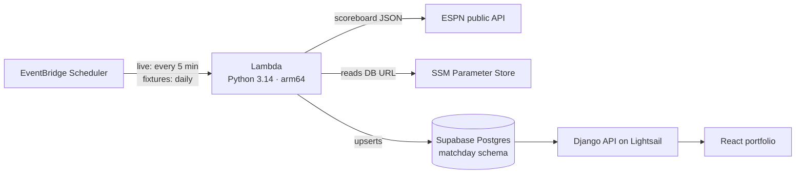

# Matchday Platform

Live La Liga and Liga MX scores for my portfolio, from a serverless data pipeline on AWS. All of the infrastructure is defined in Terraform.

> 🟢 **Status:** The ingestion pipeline is live. Next: serve the scores through the Django API and show them in the React portfolio.

## Architecture



- **`fixtures` (daily):** loads every match from yesterday to 7 days ahead.
- **`live` (every 5 min):** checks the database for a match in progress. If none, it exits **without calling ESPN**. Otherwise it fetches only the scoreboards it needs and updates scores, clocks and statuses.

## Tech stack

- **Terraform**: all AWS infrastructure, with remote state in S3
- **AWS**: Lambda, EventBridge Scheduler, IAM, SSM Parameter Store, CloudWatch Logs, S3, Budgets
- **Python**: `requests` and `psycopg` 3
- **Supabase**: managed Postgres
- **Django + React on Lightsail**: the existing portfolio that will display the scores

## Project structure

```
matchday-platform/
├── infra/
│   ├── bootstrap/    # Budget alert + S3 bucket for Terraform state (local state)
│   ├── database/     # SQL migrations: matchday schema, least-privilege ingest role
│   └── ingestion/    # Lambda, IAM roles, schedules, log group (state in S3)
└── services/
    └── ingestion/    # Lambda code (handler.py) and build script
```

## Design decisions

- **Serverless instead of containers.** The job runs a few seconds every 5 minutes. On Lambda that's effectively **$0/month**, compared with about $13/month for the smallest always-on Fargate task. There's no VPC, so there's no NAT gateway either (about $32/month).
- **Only call ESPN while a match is live.** A database check comes first, which cuts ESPN calls from about 576 a day to about 18 plus live windows.
- **ESPN IDs as primary keys.** Every write is an idempotent upsert (`insert ... on conflict do update`), so re-runs never create duplicates and nothing depends on matching team names.
- **Least privilege throughout:**
  - The Lambda's IAM role can write only to its own log group and read only one SSM parameter. It has no permission to create log groups, so the 14-day retention group can't be bypassed.
  - The scheduler's role can invoke only this function, with an `aws:SourceAccount` condition against confused-deputy attacks.
  - The Lambda connects to Postgres as a dedicated `matchday_ingest` role that can only select, insert and update the `matchday` schema, with no delete.
- **Secrets stay out of git and Terraform state.** The database URL is an SSM `SecureString` created with the CLI. Terraform only knows its name.
- **Separate schema, locked down.** `matchday` is kept apart from the Django app's tables, RLS is enabled, and Supabase's public API roles have no access.
- **Time zones handled explicitly.** Kickoffs are stored as `timestamptz` (UTC). ESPN's `dates` parameter uses US Eastern time, so live lookups convert before querying.
- **Failed runs aren't retried.** Lambda's async retries are disabled, because the next scheduled run replaces a failed one.

## Getting started

### Prerequisites

- Terraform >= 1.10
- AWS CLI v2, logged in to the target account
- Python 3.14
- A Supabase (or any Postgres) database

### 1. Bootstrap (budget alert + state bucket)

```bash
cd infra/bootstrap
echo 'alert_email = "you@example.com"' > terraform.tfvars
terraform init
terraform apply
```

`terraform.tfvars` is gitignored, so your email stays out of the repo.

### 2. Database

Run `infra/database/001_initial_schema.sql`, then `002_ingestion_role.sql`, in your database's SQL editor. Then set the ingest role's password. Don't save this command anywhere:

```sql
alter role matchday_ingest with password '<strong-random-password>';
```

### 3. Store the connection string in SSM

```bash
aws ssm put-parameter \
  --name /matchday/database-url \
  --type SecureString \
  --value "postgresql://matchday_ingest.<project-ref>:<password>@<pooler-host>:6543/postgres"
```

### 4. Build and deploy the pipeline

```bash
services/ingestion/build.sh
cd infra/ingestion
terraform init
terraform apply
```

After any change to `handler.py`: run `build.sh`, then `terraform apply`.

### Run locally

```bash
cd services/ingestion
python -m venv .venv && source .venv/bin/activate
pip install -r requirements.txt
export DATABASE_URL="postgresql://..."
python handler.py fixtures
python handler.py live
```

## Roadmap

- [x] Budget alert and S3 remote state
- [x] Database schema and least-privilege ingest role
- [x] Ingestion Lambda (ESPN → Supabase) with live-window check
- [x] Scheduled runs: live every 5 min, fixtures daily
- [ ] Django API endpoint for matches
- [ ] Live scores in the React portfolio
- [ ] Match events (goals, cards) and Liguilla playoff details

## Cost

| Item | Monthly |
|---|---|
| Lambda, EventBridge, SSM, CloudWatch Logs, S3 | ~$0 (inside the free tier; ~$0.05 without it) |
| Supabase | $0 (free tier) |

A $20/month AWS budget sends an email when actual spend passes 80% or forecast spend passes 100%.

## Data source

Scores come from ESPN's public scoreboard JSON. It's unofficial and undocumented and could change without notice, so all ESPN-specific code is in `fetch_scoreboard` and `parse_event` and can be swapped for another source. The pipeline polls politely and only during live windows. *Scores via ESPN.*